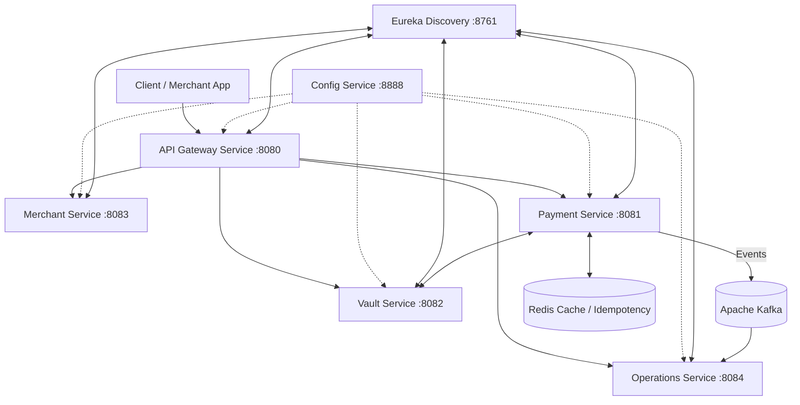

# Payment Gateway Microservices Application

A high-throughput, distributed payment gateway architecture built with **Java 25**, **Spring Boot 4 / Spring Cloud**, **Apache Kafka**, **Redis**, and **Docker**.

---

## 🏛 Architecture Overview

The system is decomposed into specialized, decoupled microservices communicating via RESTful APIs and asynchronous Kafka event streaming:



---

## 📦 Microservices Breakdown

| Service | Description | Tech Stack |
| :--- | :--- | :--- |
| **`discovery-service`** | Service registration and dynamic lookup (Eureka Server). | Spring Cloud Netflix Eureka |
| **`config-service`** | Centralized configuration management across all environments. | Spring Cloud Config Server |
| **`api-gateway-service`** | Unified ingress, route balancing, security filters, rate limiting. | Spring Cloud Gateway |
| **`payment-service`** | Core payment orchestration, transactions, state machines, charges, and event publishing. | Spring Boot, JPA, Kafka, Redis |
| **`merchant-service`** | Merchant onboarding, API keys, webhook configurations, and profile management. | Spring Boot, Spring Data JPA |
| **`vault-service`** | Tokenization service for sensitive card data (simulated PCI-DSS isolation). | Spring Boot, AES Encryption / Tokenizer |
| **`operations-service`** | Settlements, chargebacks, ledger reconciliation, and operations auditing. | Spring Boot, Kafka Consumers |
| **`common-lib`** | Shared library containing domain DTOs, Kafka event definitions, and error handling. | Spring Boot, MapStruct |
| **`observability`** | System metrics, dashboards, and distributed tracing. | Prometheus, Grafana, Docker Compose |

---

## 🚀 Getting Started

### Prerequisites
- **JDK 25** (or compatible Java version)
- **Maven 3.9+** (or included `mvnw` wrappers)
- **Docker & Docker Compose** (for Kafka, Redis, PostgreSQL, Prometheus, Grafana)

### Startup Sequence
To ensure services resolve configuration and discovery smoothly, boot services in the following order:

1. **Infrastructure**:
   ```bash
   cd observability
   docker compose up -d
   ```
2. **Discovery & Config**:
   - `discovery-service` (Eureka Server)
   - `config-service` (Config Server)
3. **Core Services**:
   - `vault-service`
   - `merchant-service`
   - `payment-service`
   - `operations-service`
4. **Ingress**:
   - `api-gateway-service`

---

## 🛠 Build & Package

Each service contains its own Maven wrapper. To build any service:
```bash
./mvnw clean package -DskipTests
```
Or for Windows PowerShell:
```powershell
.\mvnw.cmd clean package -DskipTests
```

---

## 🛡 Security & Best Practices
- **Data Protection**: Card numbers and sensitive credentials are encrypted and stored in `vault-service`.
- **Idempotency**: Payment requests enforce unique idempotency keys via Redis to prevent double-charging.
- **Resilience**: Asynchronous event publishing ensures reliable processing and fault tolerance across distributed transactions.
